# Sitemap FairFlat — «Чесна квартира»

Структура сторінок вебплатформи для купівлі, продажу та оренди нерухомості. Документ складено на основі User Stories (US-01 – US-53) і відповідає завданню «Структура продукту та sitemap».

## Зміст

1. [Ролі користувачів](#1-ролі-користувачів)
2. [Sitemap (схема переходів)](#2-sitemap-схема-переходів)
3. [Умовні позначення](#3-умовні-позначення)
4. [Опис сторінок](#4-опис-сторінок)
5. [Погодження з командою](#5-погодження-з-командою)
6. [Рядок для README.md](#6-рядок-для-readmemd)

---

## 1. Ролі користувачів

| Роль | Що може |
|---|---|
| Гість | Переглядає оголошення, карту, каталог рієлторів, профілі, порівнює об'єкти, користується калькулятором іпотеки та оцінкою вартості |
| Користувач | Усе, що гість, плюс обране, збережені пошуки, повідомлення, запити на огляд і заявки на оренду, власні оголошення, відгуки |
| Рієлтор / агентство | Користувач із підтвердженим професійним профілем: публікує оголошення від свого імені, має сторінку в каталозі, керує командою |
| Модератор | Перевіряє оголошення, скарги, відгуки та заявки на професійний профіль |
| Адміністратор | Керує користувачами, довідниками, ML-моделлю, дивиться статистику платформи |

---

## 2. Sitemap (схема переходів)

```mermaid
flowchart TB
    classDef modal fill:#fef3c7,stroke:#d97706,stroke-width:1.5px,stroke-dasharray: 4 4;
    classDef ml fill:#ecfdf5,stroke:#059669,stroke-width:2px;
    classDef pro fill:#e0e7ff,stroke:#4338ca,stroke-width:1.5px;
    classDef mod fill:#fce7f3,stroke:#be185d,stroke-width:1.5px;
    classDef adm fill:#f3e8ff,stroke:#7e22ce,stroke-width:1.5px;

    Home["Головна сторінка Landing"]
    AuthModal["Модальне вікно: Вхід / Реєстрація"]:::modal
    PasswordReset["Відновлення пароля (лист на email, новий пароль)"]
    Home -.->|Клік Увійти| AuthModal
    AuthModal -.->|Забули пароль| PasswordReset
    PasswordReset -->|Пароль змінено| AuthModal

    subgraph GUEST_ZONE ["Доступно гостю без реєстрації"]
        ListingsView["Список оголошень (Купити / Орендувати, пошук, фільтри, сортування)"]
        MapView["Перегляд оголошень на карті"]
        MarkerInfo["Міні-картка мітки на карті"]
        Details["Детальна сторінка оголошення (фото, карта, контакти, індикатор ціни, Поділитися)"]
        Compare["Порівняння оголошень (2-4 об'єкти)"]
        MortgageCalc["Калькулятор іпотеки"]
        Predictor["Оцінка вартості житла (ML LightGBM)"]:::ml
        RealtorsList["Каталог рієлторів та агентств (пошук, фільтри)"]
        OwnerPage["Публічний профіль власника"]
        RealtorPage["Сторінка рієлтора (контакти, відгуки, оголошення)"]
        AgencyPage["Сторінка агентства (команда, відгуки, оголошення)"]
    end
    style GUEST_ZONE fill:#f9fafb,stroke:#9ca3af,stroke-width:1.5px

    Home -->|Перегляд пропозицій| ListingsView
    Home -->|Оголошення на карті| MapView
    Home -->|Каталог рієлторів| RealtorsList
    Home -->|Оцінка вартості| Predictor
    Home -->|Калькулятор іпотеки| MortgageCalc

    ListingsView -->|Відкрити оголошення| Details
    MapView -->|Клік по мітці| MarkerInfo
    MarkerInfo -->|Детальніше| Details
    Details -->|Додати до порівняння| Compare
    Details -->|Розрахувати іпотеку| MortgageCalc
    Details -->|Автор: власник| OwnerPage
    Details -->|Автор: рієлтор| RealtorPage
    Details -->|Автор: агентство| AgencyPage
    RealtorsList -->|Рієлтор| RealtorPage
    RealtorsList -->|Агентство| AgencyPage
    AgencyPage -->|Рієлтори команди| RealtorPage
    OwnerPage -->|Активні оголошення| Details
    RealtorPage -->|Активні оголошення| Details
    AgencyPage -->|Активні оголошення| Details

    subgraph AUTH_FEATURES ["Дії, що потребують входу або реєстрації"]
        TourModal["Модалка: Запит на огляд"]:::modal
        RentModal["Модалка: Заявка на оренду"]:::modal
        ReportModal["Модалка: Скарга на оголошення"]:::modal
        ReviewModal["Модалка: Відгук і оцінка рієлтора / агентства"]:::modal
    end

    Details -.->|Гість натиснув дію| AuthModal
    AuthModal ==>|Успішний вхід, повернення до дії| Details
    Details -.->|Потрібен вхід| TourModal
    Details -.->|Потрібен вхід| RentModal
    Details -.->|Потрібен вхід| ReportModal
    RealtorPage -.->|Потрібен вхід| ReviewModal
    AgencyPage -.->|Потрібен вхід| ReviewModal

    subgraph USER_ZONE ["Базовий кабінет (Покупець / Орендар / Власник)"]
        UserDash["Огляд кабінету користувача"]
        MyListings["Мої оголошення (статуси, фільтри)"]
        ListingForm["Створення / редагування оголошення (фото, чернетка)"]
        ListingStats["Статистика оголошення (7 / 30 днів)"]
        Inbox["Вхідні: повідомлення, запити на огляд, заявки на оренду"]
        MyRequests["Мої запити на огляд та заявки на оренду (статуси)"]
        Favorites["Обране"]
        SavedSearches["Збережені пошуки та сповіщення"]
        RecentlyViewed["Нещодавно переглянуті"]
        UserSettings["Налаштування профілю (дані, пароль)"]
        ProApply["Заявка на статус рієлтора / агентства"]

        UserDash --> MyListings
        UserDash --> Inbox
        UserDash --> MyRequests
        UserDash --> Favorites
        UserDash --> SavedSearches
        UserDash --> RecentlyViewed
        UserDash --> UserSettings

        MyListings -->|Створити / Редагувати| ListingForm
        MyListings -->|Статистика| ListingStats
        UserSettings -->|Кнопка Стати рієлтором| ProApply
        ListingForm -.->|Кнопка Оцінити ціну| Predictor
    end

    subgraph PRO_ZONE ["Професійний кабінет (Рієлтор / Агентство)"]
        ProDash["Панель управління рієлтора / агентства"]:::pro
        ProListings["Оголошення агентства / рієлтора"]:::pro
        TeamControl["Керування командою (запрошення за email)"]:::pro
        AgencyStats["Розширена статистика оголошень та звернень"]:::pro
        PublicPageEdit["Керування публічним профілем"]:::pro

        ProDash --> ProListings
        ProDash --> TeamControl
        ProDash --> AgencyStats
        ProDash --> PublicPageEdit

        ProListings -->|Створити / Редагувати| ListingForm
        ProListings -.->|Оцінка вартості об'єктів клієнтів| Predictor
    end
    style PRO_ZONE fill:#eef2ff,stroke:#6366f1,stroke-width:1.5px

    ProDash -.->|Звернення клієнтів| Inbox

    AuthModal -.->|Вхід як звичайний користувач| UserDash
    AuthModal -.->|Вхід зі статусом Pro| ProDash
    Home -->|Профіль у хедері якщо залогінений| UserDash

    Details -.->|Потрібен вхід| Favorites
    Details -.->|Потрібен вхід, написати власнику| Inbox
    ListingsView -.->|Зберегти пошук, потрібен вхід| SavedSearches
    Details -.->|Автоматично, для залогіненого| RecentlyViewed
    TourModal -.->|Статус запиту| MyRequests
    RentModal -.->|Статус заявки| MyRequests

    subgraph MOD_ZONE ["Модерація"]
        ModDash["Панель модератора"]:::mod
        ModListings["Модерація нових та відредагованих оголошень"]:::mod
        ModComplaints["Скарги на оголошення та відгуки"]:::mod
        ModProfiles["Перевірка заявок рієлторів та агентств"]:::mod

        ModDash --> ModListings
        ModDash --> ModComplaints
        ModDash --> ModProfiles
    end
    style MOD_ZONE fill:#fdf2f8,stroke:#be185d,stroke-width:1.5px

    subgraph ADMIN_ZONE ["Адміністрування"]
        AdminDash["Панель адміністратора"]:::adm
        UsersControl["Керування користувачами (блокування)"]:::adm
        Dictionaries["Керування довідниками (міста, типи, стани ремонту)"]:::adm
        MLControl["Модель LightGBM: метрики, версії, відкат"]:::ml
        PlatformStats["Статистика платформи"]:::adm

        AdminDash --> UsersControl
        AdminDash --> Dictionaries
        AdminDash --> MLControl
        AdminDash --> PlatformStats
    end
    style ADMIN_ZONE fill:#faf5ff,stroke:#7e22ce,stroke-width:1.5px

    UserDash -.->|Роль Модератор| ModDash
    UserDash -.->|Роль Адмін| AdminDash

    ListingForm -.->|Відправлено на модерацію| ModListings
    ModListings -.->|Схвалено, з'являється в пошуку| ListingsView
    ReportModal -.->|Скарга| ModComplaints
    RealtorPage -.->|Скарга на відгук| ModComplaints
    ProApply -.->|Заявка на перевірці| ModProfiles
    ModProfiles -.->|Схвалено, статус Pro| ProDash
```



---

## 3. Умовні позначення

| Позначення | Значення |
|---|---|
| Суцільна стрілка | Звичайний перехід між сторінками |
| Пунктирна стрілка | Умовний перехід: потрібен вхід, роль, схвалення або автоматична дія |
| Товста стрілка | Повернення до дії після успішного входу |
| Жовтий пунктирний блок | Модальне вікно |
| Зелений блок | ML-функціональність (LightGBM) |
| Синій блок | Професійний кабінет (рієлтор / агентство) |
| Рожевий блок | Модерація |
| Фіолетовий блок | Адміністрування |

---

## 4. Опис сторінок

Колонка «US» посилається на User Stories з файлу вимог.

### 4.1. Публічна частина (доступна гостю)

| Сторінка | Призначення | Основні елементи | US |
|---|---|---|---|
| Головна (Landing) | Точка входу на сайт. Веде до пошуку, карти, каталогу рієлторів, оцінки вартості та калькулятора іпотеки. | Хедер із кнопкою «Увійти» або профілем, блок пошуку, посилання на основні розділи | US-05, US-06 |
| Модальне вікно «Вхід / Реєстрація» | Дає змогу створити акаунт або увійти. Відкривається, коли гість натискає дію, що потребує входу. | Форми входу й реєстрації, повідомлення про помилки, посилання «Забули пароль?» | US-01, US-02 |
| Відновлення пароля | Скидання забутого пароля через email. | Поле email, лист із посиланням (дійсне 1 годину), форма нового пароля | US-03 |
| Список оголошень | Головна сторінка пошуку житла. Показує оголошення з фільтрами та сортуванням. | Перемикач «Купити / Орендувати», пошук із підказками, фільтри (включно з оренди та «Автор оголошення»), сортування, картки з серцем, пагінація по 20, кнопка «Зберегти пошук» | US-05–08, US-12, US-21, US-47 |
| Перегляд на карті | Показує оголошення маркерами на карті з урахуванням активних фільтрів. | Перемикач «Список / Карта», маркери, фільтри | US-09 |
| Міні-картка мітки | Коротка інформація про оголошення при кліку на маркер. | Фото, ціна, посилання на оголошення | US-09 |
| Детальна сторінка оголошення | Повна інформація про об'єкт і точка для зв'язку з автором. | Галерея, ціна, адреса, характеристики, опис, карта, умови оренди, контакти, «Показати телефон», «Написати власнику», «Поділитися», «Поскаржитися», обране, порівняння, індикатор ціни моделі | US-10, US-11, US-15–19, US-35, US-36 |
| Порівняння оголошень | Таблиця з параметрами 2–4 об'єктів одного типу угоди. | Таблиця (ціна, площа, кімнати, поверх, ціна за м²), кнопка видалення з порівняння, повідомлення про ліміт | US-13 |
| Калькулятор іпотеки | Розрахунок щомісячного платежу й переплати. | Поля вартості, першого внеску, ставки та терміну, результат, підстановка ціни з оголошення | US-14 |
| Оцінка вартості житла | Орієнтовна ціна продажу за характеристиками від моделі LightGBM. | Форма з 8 полів, результат у USD із діапазоном, 3–5 найвпливовіших ознак, застереження про орієнтовність | US-33, US-36 |
| Каталог рієлторів та агентств | Пошук професіонала серед перевірених профілів. | Пошук, фільтри (місто, тип, спеціалізація, рейтинг), сортування, картки, пагінація по 20 | US-44, US-45 |
| Сторінка рієлтора | Профіль рієлтора з відгуками й активними оголошеннями. | Фото, опис, місто, спеціалізація, контакти, рейтинг, відгуки, оголошення, «Написати», «Показати телефон» | US-46, US-48 |
| Сторінка агентства | Профіль агентства, схожий на сторінку рієлтора, плюс список команди. | Логотип, опис, контакти, рейтинг, відгуки, оголошення, список рієлторів із посиланнями | US-46, US-51 |
| Профіль власника | Допомагає оцінити довіру до приватного власника. | Ім'я, фото, дата реєстрації, кількість активних оголошень, їхній список (без email) | US-32 |

### 4.2. Модальні вікна (потрібен вхід)

| Модалка | Призначення | Основні елементи | US |
|---|---|---|---|
| Запит на огляд | Запропонувати власнику дату й час особистого перегляду. | Вибір дати (не раніше завтра) і часу | US-17 |
| Заявка на оренду | Подати заявку на заселення. | Бажана дата заселення, термін оренди, коментар, повідомлення про помилку мінімального терміну | US-23 |
| Скарга на оголошення | Повідомити модератору про підозріле оголошення. | Вибір причини, коментар | US-19 |
| Відгук і оцінка | Залишити оцінку та відгук про рієлтора чи агентство. | Оцінка 1–5, текст до 1000 символів | US-48 |

### 4.3. Кабінет користувача

| Сторінка | Призначення | Основні елементи | US |
|---|---|---|---|
| Огляд кабінету | Вхідна сторінка кабінету з навігацією по розділах. | Меню розділів | — |
| Мої оголошення | Усі оголошення користувача в одному місці з поточним станом. | Список зі статусами, фільтр за статусом і типом угоди, причина відхилення, дії «Продано / Здано / В архів / Видалити» | US-28, US-29 |
| Створення та редагування оголошення | Форма публікації продажу чи оренди. | Тип угоди, обов'язкові поля, завантаження фото (до 20, головне фото, порядок), чернетка, кнопка «Оцінити ціну» | US-22, US-25–27, US-34 |
| Статистика оголошення | Показує інтерес до оголошення. | Перегляди, додавання в обране, звернення, перемикач 7 / 30 днів | US-30 |
| Вхідні | Єдиний розділ звернень до власника. | Чат, запити на огляд (підтвердити / відхилити), заявки на оренду (прийняти / відхилити), індикатор непрочитаного | US-15, US-17, US-24, US-31 |
| Мої запити та заявки | Статуси власних запитів на огляд і заявок на оренду. | Список зі статусами «Очікує», «Підтверджено / Прийнята», «Відхилено / Відхилена» | US-17, US-23 |
| Обране | Збережені оголошення. | Список карток із серцем | US-11 |
| Збережені пошуки | Збережені набори фільтрів зі сповіщеннями. | Список пошуків, редагування, видалення, вимкнення сповіщень | US-12 |
| Нещодавно переглянуті | Історія останніх 20 переглядів. | Список, кнопка «Очистити» | US-20 |
| Налаштування профілю | Редагування особистих даних і пароля. | Ім'я, телефон, фото, зміна пароля, кнопка «Стати рієлтором» | US-04 |
| Заявка на професійний профіль | Подання заявки на статус рієлтора або агентства. | Форма (тип, ім'я чи назва, місто, телефон, опис, фото; ЄДРПОУ для агентства), статус «На перевірці» | US-49 |

### 4.4. Професійний кабінет (рієлтор / агентство)

| Сторінка | Призначення | Основні елементи | US |
|---|---|---|---|
| Панель управління | Вхідна сторінка професійного кабінету. | Меню розділів | — |
| Оголошення агентства / рієлтора | Керування оголошеннями від імені профілю. | Список оголошень, створення й редагування, оцінка вартості об'єктів клієнтів | US-22, US-25–29 |
| Керування командою | Склад агентства. | Запрошення рієлтора за email, вилучення з команди | US-51 |
| Розширена статистика | Зведена статистика оголошень і звернень. | Показники переглядів і звернень | Окремої US немає |
| Керування публічним профілем | Редагування сторінки в каталозі. | Фото чи логотип, опис, контакти | Окремої US немає |

### 4.5. Модерація

| Сторінка | Призначення | Основні елементи | US |
|---|---|---|---|
| Панель модератора | Вхідна сторінка модератора. | Меню черг | — |
| Модерація оголошень | Перевірка нових і відредагованих оголошень. | Черга (старі першими), «Схвалити», «Відхилити» з причиною | US-39 |
| Скарги | Розгляд скарг на оголошення й відгуки. | Список скарг, дії: відхилити скаргу, приховати оголошення чи відгук, заблокувати автора | US-40, US-52 |
| Перевірка заявок рієлторів та агентств | Підтвердження професійних профілів. | Черга заявок, «Схвалити», «Відхилити» з причиною | US-50 |

### 4.6. Адміністрування

| Сторінка | Призначення | Основні елементи | US |
|---|---|---|---|
| Панель адміністратора | Вхідна сторінка адміністратора. | Меню розділів | — |
| Керування користувачами | Блокування та розблокування акаунтів. | Пошук за email чи іменем, кнопки «Заблокувати / Розблокувати» | US-41 |
| Керування довідниками | Редагування міст, типів нерухомості, станів ремонту. | Додавання, зміна, вимкнення значень | US-42 |
| Модель LightGBM | Версії та якість ML-моделі. | Поточна версія, дата навчання, метрика, завантаження нової версії, відкат | US-37, US-38 |
| Статистика платформи | Ключові показники розвитку сервісу. | Користувачі, активні оголошення (продаж / оренда), нові оголошення, виконані оцінки; період 7 / 30 днів / весь час | US-43 |

### 4.7. Примітки

- Адаптивність (US-53) стосується всіх сторінок і окремого вузла в схемі не має.
- Для «Розширеної статистики» та «Керування публічним профілем» у поточних User Stories немає окремих історій. Їх варто або додати до вимог, або прибрати зі схеми.
- Оцінка вартості, калькулятор іпотеки й порівняння доступні гостю, оскільки в US-33, US-14 і US-13 вхід не вимагається.

---

## 5. Погодження з командою

- [ ] Діма Чубайко
- [ ] Артем
- [ ] Діма Бурла
- [ ] Ілля

---

## 6. Рядок для README.md

```markdown
## Структура продукту

Sitemap і опис сторінок: [docs/sitemap.md](docs/sitemap.md)
```
